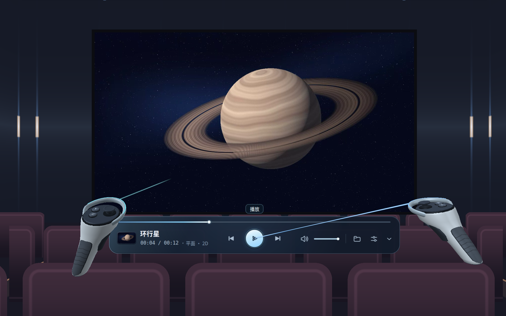

# 空间影院

openKylin XR 的原生空间视频播放器。Rust 驱动 OpenXR 帧循环、手柄输入和 Vulkan 渲染，GStreamer 负责本地影片解码与音视频同步。影院带有阶梯座椅、壁灯和银幕，也可切换到暗场。银幕下沿的控制栏采用深墨蓝玻璃、桌面焦点蓝和 Noto Sans CJK SC 字体，片库与画面设置从栏上展开。



## 安装和首次播放

随包演示片覆盖 9 种投影与分眼组合，有电影、全景实拍和原创立体动画。[片单与素材来源](assets/demos/片单.md)

将对应架构的安装包复制到设备，在包所在目录运行以下命令。已验证的系统包括 openKylin 3.0 ARM64 和 openKylin 2.0 SP2 RISC-V 64。目标图形会话需要可用的 Vulkan 驱动和支持 `XR_KHR_vulkan_enable2` 的 OpenXR 运行时。

```sh
sudo apt install "./xr-cinema_0.3.0_$(dpkg --print-architecture).deb"
```

连接头显，在 HyperSpace 底部 Dock 最左侧打开 **应用库**，翻页找到 **空间影院**。进入影院后，点播放栏的文件夹，选择 **演示片库** 即可试播。如果在 HyperSpace 运行期间安装了影院，重新打开 HyperSpace 会刷新应用列表。

演示片会自动设置投影和分眼方式。选择「返回本地片库」可浏览系统视频目录。两种片库均可翻页，「上一部」「下一部」在选中影片所属列表中循环。

桌面启动器使用当前 XR 会话的运行目录。在提供会话管理接口的 Monado 或 WiVRn 中，它将影院切到前台。退出时，如果原应用仍在运行，且用户未切到第三个应用，启动器会恢复原应用。文件管理器的「打开方式」支持将本地视频交给已运行的影院。

```sh
xr-cinema-desktop --demo
xr-cinema --list-demos
xr-cinema-desktop --demo=vr180-sbs
xr-cinema-desktop --projection 180 --stereo sbs "/home/me/Videos/旅行 VR180.mp4"
xr-cinema-desktop --projection 360 --stereo tb "/home/me/Videos/全景.mkv"
xr-cinema-desktop --library "/media/me/影片"
```

`xr-cinema` 可直接启动 OpenXR 客户端。多个文件参数构成按给定顺序播放的列表。再次启动时可传入单个文件，原会话会打开该文件并显示控制面板。若系统配置了多个运行时，可在启动前将 `XR_RUNTIME_JSON` 设为所选运行时的 manifest 绝对路径。

## 画面与手柄

播放时，控制栏上沿是可拖动的时间轨。中央主键切换播放／暂停，两侧切换影片。点扬声器静音，再点恢复原音量；拖动旁边的短滑轨可调音量。右侧文件夹打开片库，画面控件打开投影、立体、场景设置。指向图标可查看操作提示。

播放中，射线离开控制栏约 4 秒后控制栏淡出。指回原位置或轻按扳机可唤回。暂停、拖动和浏览设置时，控制栏保持可见。

左右手柄的扳机、面键和摇杆会随输入动作。操作手的射线从模型前端的发射窗延伸到瞄准点，指向可操作控件时显示光环，按住扳机时光环收紧。另一只手保留短指示线；拖动进度条或音量时，控制权留在按下扳机的那只手。

**画面** 页分别设置投影与立体格式。2D 电影选择「平面 + 单眼」。等距柱状全景选择 180° 或 360°，再按片源选择单眼、左右（SBS）或上下（TB）。180° 视频覆盖正前方半球，转向背面时显示所选环境。

立体素材默认按全宽／全高编码解释，左半幅或上半幅送往左眼。半宽 SBS 或半高 TB 电影请打开「半宽／半高」以恢复银幕比例。左右眼视差相反时可点「交换左右眼」。双鱼眼原片需先拼接为等距柱状格式。本版显示路径为 8 位 SDR。

| 操作 | 手柄交互 |
| --- | --- |
| 指向与选择 | 左右手均可用。射线指向面板出现光标，按下扳机并在同一按钮上松开即执行。 |
| 拖进度或音量 | 在滑块按下扳机，拖动预览，在面板内松开提交。移出面板松开或跟踪中断会取消。 |
| 播放、暂停 | A / X 或中央主键。手动收起控制栏后也可按扳机切换播放。 |
| 显示、收起面板 | B / Y 或设备提供的应用菜单键。 |
| 快进、快退 | 摇杆向右／左跳 10 秒。持续推动可重复。 |
| 调音量 | 摇杆向上／下调整 5%。 |
| 切换影片 | 左摇杆按下切上一部，右摇杆按下切下一部。 |
| 重设座位正前方 | 正视想要的方向后按握持键，或选择「画面 → 重设正前方」。 |

已配置 Khronos Simple Controller、Touch、Valve Index、Vive Wand，以及运行时公布相应扩展时的 PICO 4 / Neo3。Vive 使用触控板，Simple Controller 可用选择键和菜单键操作整个面板。对应按钮和触觉能力由运行时公布的设备配置决定。

## 本地智能控制接口 v1

语言识别或 AI Agent 可将意图映射到命令。命令行和头显操作共享同一个播放器状态。例如，收到「跳到两分钟并暂停」时，可依次执行以下两条指令。

```sh
xr-cinema ctl '{"op":"seek","seconds":120}'
xr-cinema ctl '{"op":"pause"}'
xr-cinema ctl '{"op":"status"}'
```

程序可直接连接 Unix stream socket `$XDG_RUNTIME_DIR/xr-cinema/control.sock`。在 HyperSpace 私有会话中，若设有 `XR_OPENXR_RUNTIME_DIR`，以该目录为准。未设置运行目录时，使用系统临时目录下的 `xr-cinema-<uid>/control.sock`。socket 位于当前用户所有的私有目录中，权限为 `0600`。

每次连接发送一行 UTF-8 JSON，末尾加换行，读取一行回复后关闭。单条请求上限 16 KiB。`id` 使用数字、短字符串或 null。回复回显 `version` 和 `id`，成功时返回 `ok:true` 和完整 `state`，失败时返回 `ok:false` 和 `error`。

```json
{"version":1,"id":"voice-42","command":{"op":"set_projection","projection":"equirect180"}}
```

| `op` | 额外字段与行为 |
| --- | --- |
| `status` | 读取当前状态 |
| `open` / `open_demo` | `open` 接受绝对 `path`。`open_demo` 接受 `--list-demos` 中的 `id`，省略时打开「环行星」。成功后 `state.demo_id` 可用于确认片目 |
| `play` / `pause` | 播放、暂停；片尾调用 `play` 从头重播 |
| `seek` | `seconds` 为非负绝对时间，已知片长时限制在片尾 |
| `volume` | `level` 取 0 至 1 |
| `set_projection` | `projection` 取 `flat`、`equirect180` 或 `equirect360` |
| `set_stereo` | `stereo` 取 `mono`、`sbs` 或 `top_bottom` |
| `set_squeezed` / `swap_eyes` | 布尔字段 `enabled` |
| `set_scene` | `scene` 取 `cinema` 或 `void` |
| `show_panel` | 布尔字段 `visible` |
| `previous` / `next` | 切换列表中的影片 |
| `recenter` / `quit` | 在有效头部姿态下重设正前方，或退出播放器 |

初始化期间即可查询 `status`。等 `state.ready` 为 true 后再发送控制命令。时间以秒计。`duration:null` 表示片长尚未知，`video_size` 为解码帧的像素宽高。`open` 成功表示管线已接受文件。Agent 可轮询 `status`，通过 `decoded_frames > 0` 确认取得了视频帧，通过 `state.error` 获取异步解码错误。`submitted_frames` 记录本次 OpenXR 会话成功提交双眼投影层的次数。

`status` 回复还包含 `state.controllers`，按左手、右手排列。每项的 `model_visible`、`ray`（`null`、`idle`、`hover` 或 `pressed`）和 `active_pointer` 可用于检查最近一次双眼提交时的手柄与指向状态。

## 构建与验证

在本仓库根目录执行以下命令。构建需要 Rust/Cargo、C 编译器、pkg-config、GLSL 编译器与 GStreamer、Pango/Cairo 的开发包。

```sh
sudo apt install build-essential pkg-config glslang-tools libcairo2-dev libpango1.0-dev \
  libgstreamer1.0-dev libgstreamer-plugins-base1.0-dev
cargo build --release --locked
sh packaging/package.sh xr-cinema_0.3.0_$(dpkg --print-architecture).deb target/release/xr-cinema
```

构建会把 GLSL 编译为 SPIR-V 并嵌入程序。打包脚本按实际 ELF 识别架构，同时安装桌面入口、会话切换工具和示例片。音视频格式支持取决于已安装的 GStreamer 解码插件。

```sh
cargo test --locked
XR_CINEMA_AUDIO_SINK=fakesink cargo test --locked video_playback -- --ignored
cargo test --locked stereo_pixels -- --ignored --nocapture
cargo test --locked controller_pixels -- --ignored --nocapture
bash tests/xr-smoke.sh target/release/xr-cinema assets/环行星.webm
python3 tests/demos.py target/release/xr-cinema assets/demos/catalog.json
```

媒体回归需要 FFmpeg 与 VP8/Vorbis 插件，像素回读需要 Vulkan ICD。端到端脚本使用独立的 Monado 服务、Mesa lavapipe、Python 3，以及无显示器时的 Xvfb。单独开发控制端时可运行 `XR_CINEMA_AUDIO_SINK=fakesink xr-cinema --headless --demo`。

**性能路径。** GStreamer 依照系统插件优先级选择可协商的解码器，按播放时钟呈现，视频队列最多保留一帧。连续 RGBA 帧直接映射 GStreamer 样本，Vulkan 仅在收到新帧时写入复用的上传缓冲，双眼共享源纹理。头部姿态按 OpenXR 预测显示时间更新，文字与面板在独立线程按需绘制。当前实现仍有 RGBA 转换和 GPU 上传开销，硬件解码器、片源分辨率和头显刷新率都影响实际吞吐量。

## 设备验证

0.3.0 已在 ARM64 的 Mali-G720 MC10 和 RISC-V 的 Milk-V TITAN（Radeon RX 9060 XT）上通过 Vulkan 双眼像素回读测试，覆盖手柄模型视差、射线近端亮度、控件落点、按压反馈和跟踪中断。该版本的手柄交互仍待实体头显佩戴复测。

0.2.0 在 ARM64 真机的 WiVRn 头显会话中播放了平面、180° 左右和 360° 上下立体影片，验证了暂停、定位和退出后恢复 HyperSpace 焦点。同版在 Milk-V TITAN 上原生构建，实际解码了 10 个演示片，并在独立的 Monado 模拟头显会话中完成 75 帧双眼提交和播放控制测试。
